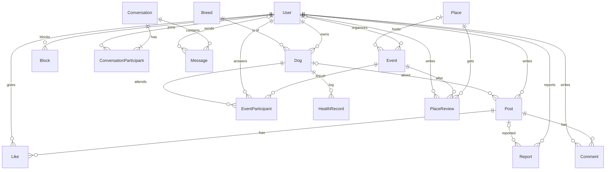
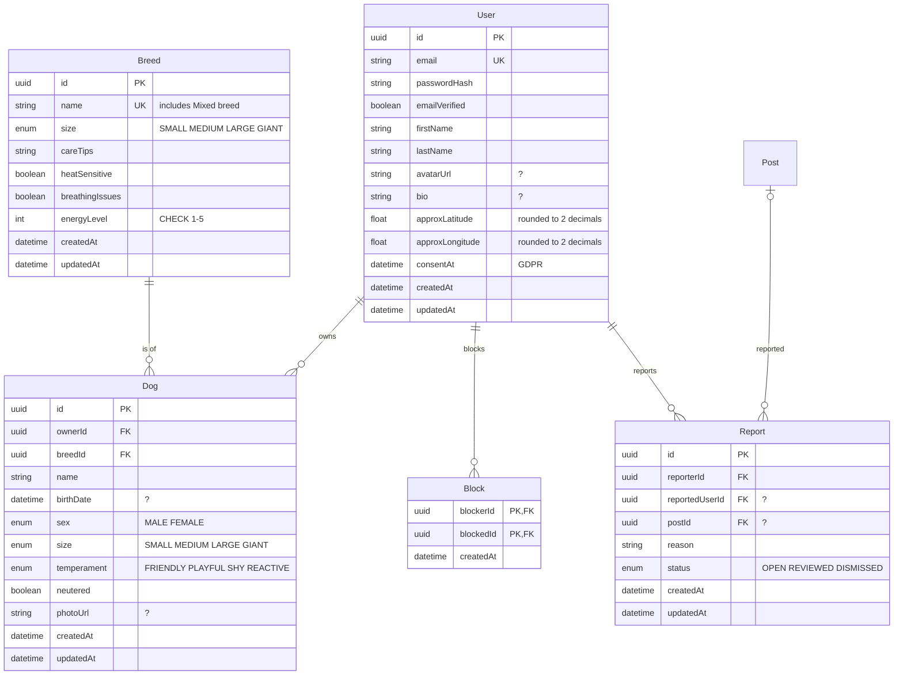
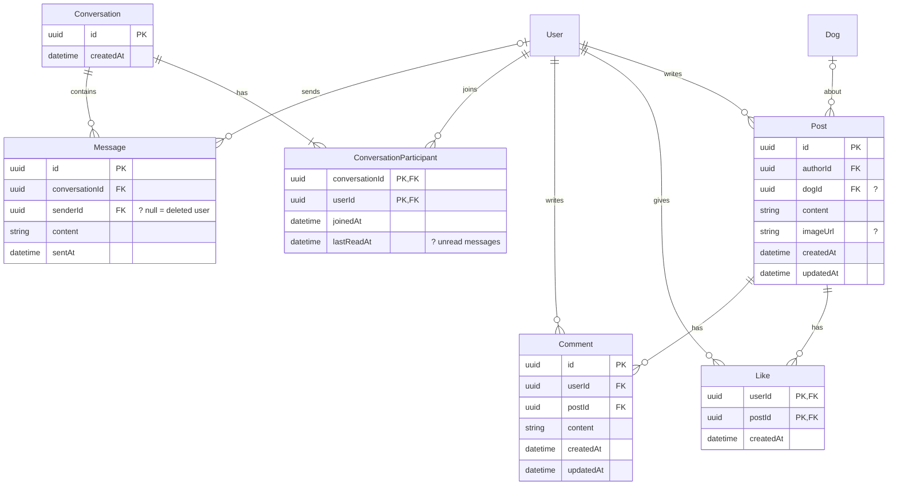
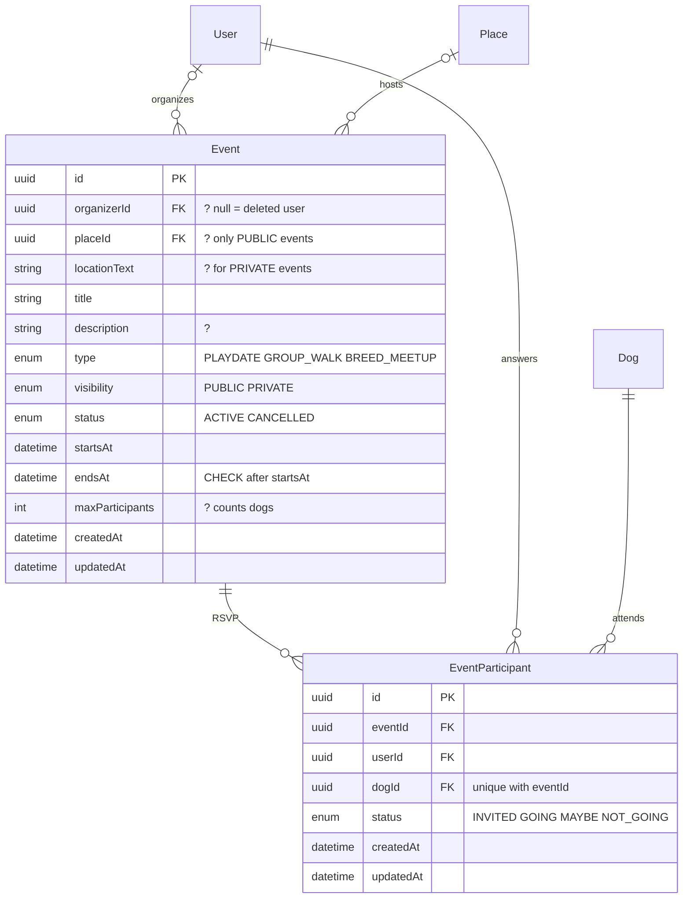
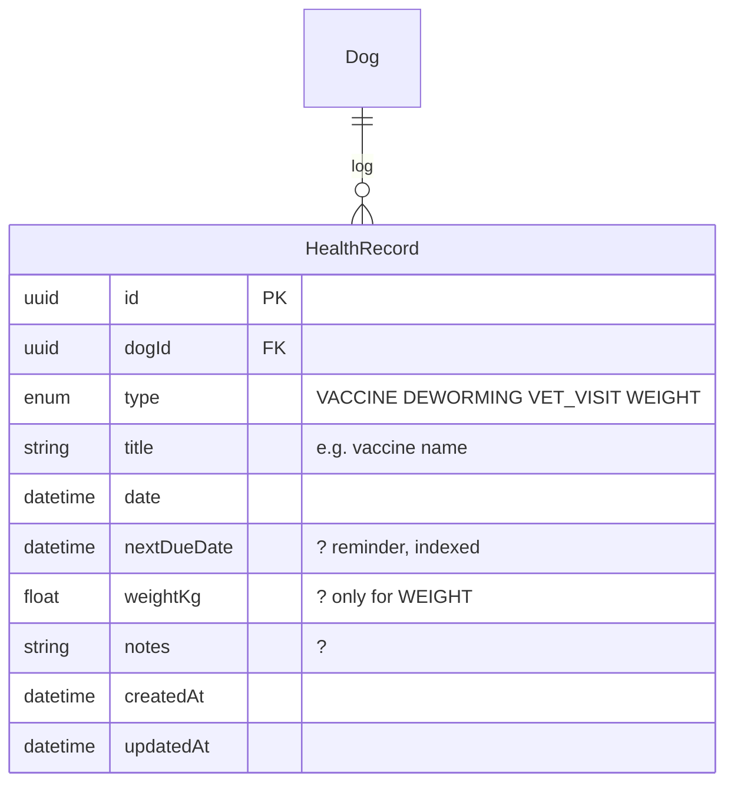
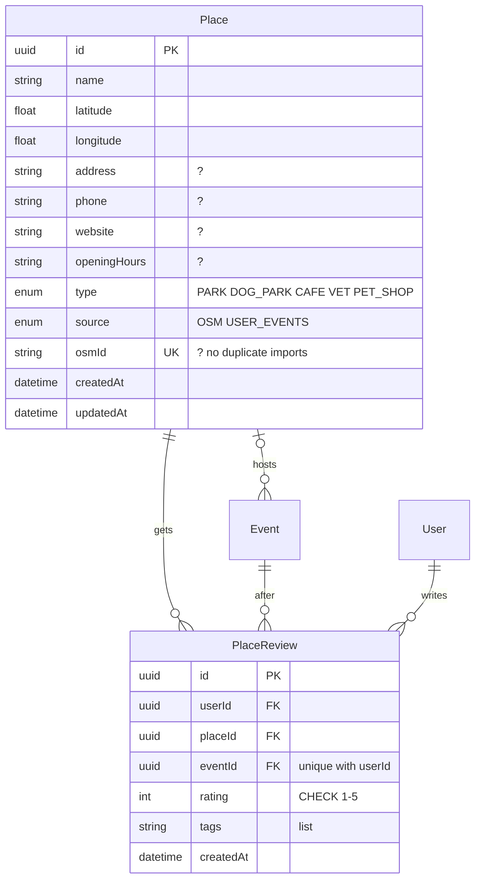

# 🗄️ Diagrama bazei de date

Schema reală din [`backend/prisma/schema.prisma`](../../backend/prisma/schema.prisma), PostgreSQL 18 · 16 tabele. Pornește de la diagrama de clase ([class-diagram.svg](class-diagram.svg)).

Notație: `PK` cheie primară · `FK` cheie străină · `UK` valoare unică · `?` câmp opțional. Toate id-urile sunt UUID.

## Imaginea de ansamblu

`||--o{` = unul la mai mulți. `|o--o{` = legătura e opțională în partea din stânga (de ex. o postare poate să nu aibă câine, un eveniment privat nu are loc pe hartă).

**Un utilizator poate avea oricâți câini** (`User 1 → N Dog`). La evenimente, fiecare câine adus are propriul rând în `EventParticipant`, unic pe `(eventId, dogId)`.

## 1. Core: căutare

Indecși: `User(approxLatitude, approxLongitude)`, `Dog(ownerId)`, `Dog(breedId)`, `Dog(size)`. `Block` și `Report` pornesc ambele din `User` pe două legături (cine blochează/raportează și cine e blocat/raportat). Un `Report` trebuie să aibă `reportedUserId` sau `postId` (CHECK), iar un utilizator nu se poate bloca pe sine (CHECK).

## 2. Social: postări și chat

`Like` are cheie compusă `(userId, postId)`, deci nu se poate da like de două ori. Mesajele necitite se calculează din `ConversationParticipant.lastReadAt`. Index pe `Message(conversationId, sentAt)`.

## 3. Întâlniri

Doar evenimentele `PUBLIC` pot avea `placeId` (CHECK); cele `PRIVATE` folosesc `locationText`, deci o întâlnire acasă la cineva nu ajunge pe hartă. Un utilizator cu doi câini are două rânduri în `EventParticipant`.

## 4. Îngrijire

Memento-urile se obțin cu o interogare pe `nextDueDate` (indexat), fără job programat.

## 5. Hartă (opțional)

O singură recenzie pe utilizator și eveniment: `unique(userId, eventId)`.

## Ce se întâmplă la ștergere

| Se șterge | Efect |
|---|---|
| **User** | Cascadă: `Dog`, `Post`, `Like`, `Comment`, `HealthRecord` (prin câine), `Block`, `Report`, `ConversationParticipant`, `EventParticipant`, `PlaceReview`. Gol (`NULL`): `Message.senderId` (apare „Utilizator șters") și `Event.organizerId` (backend-ul trece evenimentul pe `CANCELLED`). |
| **Dog** | Cascadă: `HealthRecord`, `EventParticipant`. `Post.dogId` devine gol, postarea rămâne. |
| **Post** | Cascadă: `Like`, `Comment`, `Report`. |
| **Breed** | Blocat cât timp există câini cu rasa respectivă. |
| **Place** | Cascadă: `PlaceReview`. `Event.placeId` devine gol. |
| **Event** | Cascadă: `EventParticipant`, `PlaceReview`. |

## Constrângeri `CHECK` (în migrare, nu în `schema.prisma`)

| Tabel | Regulă |
|---|---|
| `Breed` | `energyLevel` între 1 și 5 |
| `PlaceReview` | `rating` între 1 și 5 |
| `Report` | `reportedUserId` sau `postId` trebuie completat |
| `Block` | `blockerId` diferit de `blockedId` |
| `Event` | `endsAt` după `startsAt` |
| `Event` | un eveniment `PRIVATE` nu are `placeId` |
